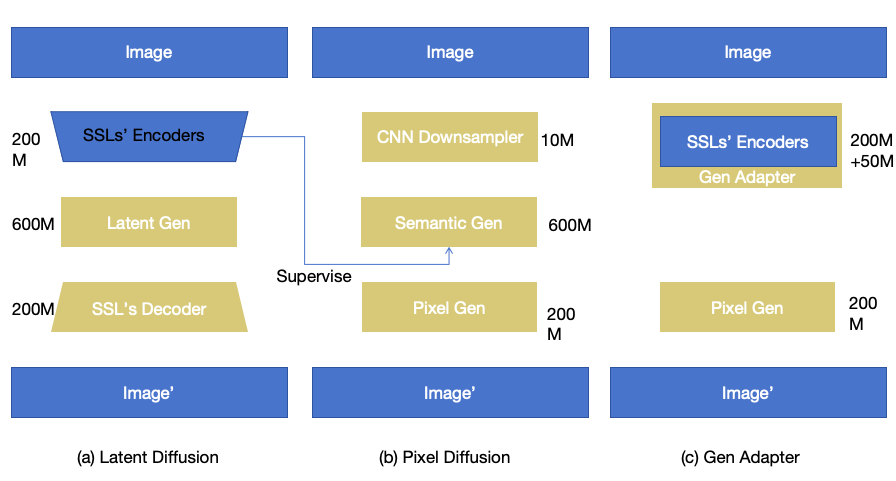
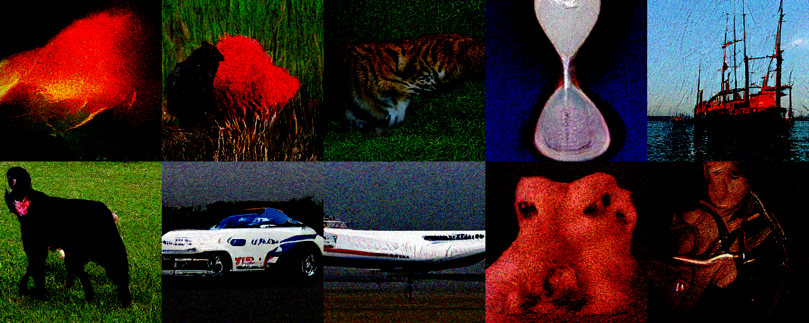
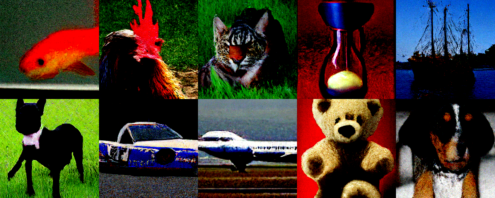
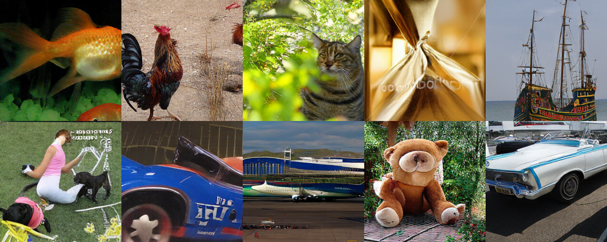
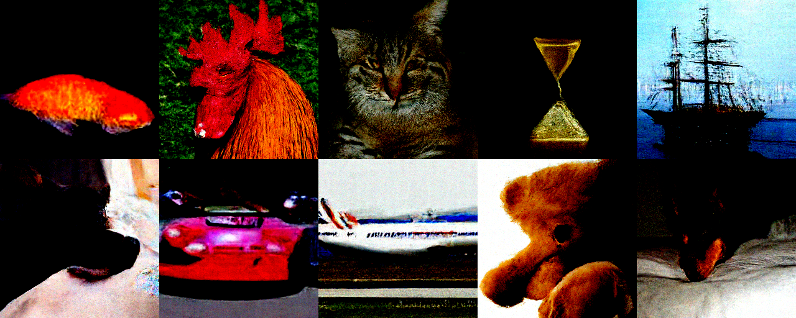

## Background

Over the past three months, I have been building a pixel-level generator. Part of the motivation is to follow an active research direction, but the more important goal is to answer three questions:

1. Can a generator directly generate pixels?
2. How far can pixel generation go?
3. How does PixelGen differ from conventional latent generation, and why might that difference matter?

The first question has largely been answered. Recent work—including Tianhong's [JiT](https://arxiv.org/abs/2511.13720), [DeCo](https://arxiv.org/abs/2511.19365), and [PixelDiT](https://arxiv.org/abs/2511.20645)—shows that direct pixel generation is viable. Its quality still trails the strongest latent-space generators, but the gap is not prohibitive.

Once other groups have shown that this path is feasible, the question becomes whether it is still worth building one ourselves. I believe it is. Implementing the system is the most direct way to understand the capability boundary of PixelGen and how its behavior differs from latent-space methods. In other words, our experiments should answer the second and third questions.

---

## What I tried

To probe the PixelGen paradigm, I designed two deliberately simple directions: one based on pixel diffusion and one based on pixel autoregression. If pixel-space generation has a genuine advantage, that advantage should not be restricted to diffusion; it should apply to any generator whose final regression target is the pixel space.

> **Method A: fine-tune DINO as a pixel generator**

The idea is simple: if the input is already an image, could we fine-tune a DINOv3 encoder to accept noisy pixels and use it as the semantic part of the generator? Its output can remain in the DINOv3 feature space, because systems such as [RAE](https://rae-dit.github.io/) and [PixelDiT](https://arxiv.org/abs/2511.20645) already train a pixel or DINO decoder to turn semantic features back into images.

The idea is also related to REPA. When DINO features supervise an intermediate diffusion representation—the blue path in the figure—the objective can be written as

$$
h_\theta(x_t, t) \approx \mathrm{DINO}_{\mathrm{teacher}}(x_0),
$$

where $h_\theta(\cdot)$ is an intermediate diffusion feature, $\mathrm{DINO}_{\mathrm{teacher}}(x_0)$ is the output of a frozen DINO encoder, $x_t$ is the noisy image, and $x_0$ is the corresponding clean image.

Taking this objective one step further gives a more direct formulation: fine-tune a DINO-style encoder so that its semantics remain consistent even when the image is noisy,

$$
\mathrm{DINO}_{\mathrm{student}}(x_t,t) \approx \mathrm{DINO}_{\mathrm{teacher}}(x_0).
$$

The student starts from the same weights as the teacher. We encode the timestep $t$ as a token and insert it before DINO's existing prefix tokens—the class token and register tokens.

Viewed as a pixel-space diffusion model, the DINO student is already a nearly perfect solution in the limit $t \to 0$:

$$
\mathrm{DINO}_{\mathrm{student}}(x_t,t) = \mathrm{DINO}_{\mathrm{teacher}}(x_0).
$$

At low noise, DINO can recover stable clean-image features. The experiment therefore asks whether fine-tuning can extend this behavior to larger values of $t$.

### Why is a perceptual encoder rarely fine-tuned into a generator?

The idea is almost suspiciously simple. One likely reason it does not transfer to conventional latent diffusion is that the latent input no longer has the same form as DINO's image input. A pretrained visual encoder cannot be reused as directly when the generative model operates on another representation.

### Experiments

#### Reproducing the baseline

We first reproduced a [PixelDiT](https://arxiv.org/abs/2511.20645)-style baseline. We chose it over JiT or DeCo because it does not require $x$-prediction, allowing us to reuse our existing $v$-prediction code, and because its setup is comparatively clean, without additional losses or extensive tricks.

The original implementation was not public, so we implemented the equations from the paper. Our objective here was not to reproduce a state-of-the-art number exactly; it was to establish a stable baseline on which we could test the idea.

The implementation is intentionally plain. A one-dimensional convolution embeds the pixel input, with both stride and kernel size set to the number of pixels in a patch—typically $16 \times 16 = 256$. This is followed by several dozen transformer blocks identical to those used in conventional latent diffusion. Each output latent is decoded by a four-layer lightweight pixel diffusion module. Its transformer block uses the global-attention design from PixelDiT.

We trained with four H100 GPUs, a batch size of $64 \times 4$, and 187,500 iterations, equivalent to 38 epochs.

The first result was already encouraging: training and inference were stable, and the baseline generated coherent samples. We then added REPA.

REPA produced a visible improvement. The result is not state of the art, but it is strong enough to make the comparison concrete. For reference, the following samples come from an autoregressive model with FID 1.27 under the same training setup.

The PixelDiT-style output remains blurrier in fine details, while its global semantic structure is in some cases stronger than the FID-1.27 AR baseline. Diffusion training is also slow; substantially longer training—toward 800 epochs—could plausibly improve it further.

The clearest conclusion from this experiment was practical: **direct pixel generation works, is straightforward to implement, trains stably, and already produces useful results.**

#### Replacing the input convolution with DINOv3-S

Next, we fine-tuned DINOv3-S as a semantic generator and used it in place of PixelDiT's semantic blocks.

The difference was small.

### Questions raised by the result

#### 1. Can a 20M–200M-parameter DINO model be adapted into a generator with LoRA?

After examining the result, I do not think DINOv3-S can simply be fine-tuned into a complete generator. Perception is essentially a single-mode task. Diffusion is close to single-mode at low noise, but not when $t \to 1$. At high noise, the network must learn directions from noise toward every plausible target on the data manifold—a fundamentally multimodal problem.

Even memorizing those alternatives likely requires more than 20M parameters. A model in the roughly 200M-parameter range may have enough capacity, but the small variant probably does not.

#### 2. If DINO is ideal near $t \to 0$, is that useful when $t \to 1$ is the hardest part?

Only partially. Replacing the convolutional input with DINO-S reduced the REPA loss faster and to a lower value. This indicates that fine-tuned DINO can process noisy inputs and help PixelDiT learn the REPA objective for $0 < t < 1$.

#### 3. Does a lower REPA loss translate into better pixels?

Our experiments suggest that it may not. Optimizing the semantic space is not the same as optimizing the pixel space, and the semantics required by a pixel decoder may not be identical to DINOv3 features. The same idea can help in the [RAE](https://rae-dit.github.io/) setting, but RAE already consumes DINO features rather than raw pixels, so it cannot directly reuse DINO as a pixel-input network.

The current evidence therefore supports a narrower conclusion: adapting DINO improves semantic denoising, but that improvement alone does not guarantee better final pixel generation.
