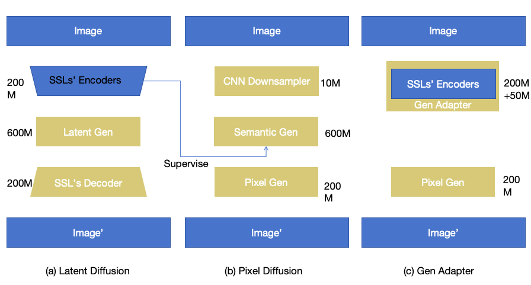

<section class="research-content-section research-content-section--lead" id="question" markdown="1">

01 / 研究问题

## 如果跳过 latent bottleneck，生成器会学到什么？

大多数图像生成器先把图像压进 latent space，再在压缩后的表示上建模。这条路线高效，但 tokenizer 或 VAE 同时决定了哪些细节会被保留、哪些会在生成开始前丢失。

PixelGen 的问题很直接：**当生成目标始终是 pixel，我们能否从输入到输出都在像素域完成建模？** 我们关心的不只是“它能不能跑”，还包括像素空间带来的表征差异、计算代价，以及它是否能支持 Diffusion 之外的生成范式。

  Working thesis
  
Pixel generation 的价值不应依附于某一种 backbone；如果它确实提供更完整的视觉信息，这个优势应当能够被 Diffusion、AR 及两者的混合架构共同利用。

</section>

<section class="research-content-section" id="approach" markdown="1">

02 / 技术路线

## 四条架构分支

  <article>A<h3>Pixel Diffusion</h3>
复现 PixelDiT-style baseline，并测试 REPA 与 DINOv3 noisy-input fine-tuning 是否能改善像素生成。
<small>已建立 baseline</small></article>
  <article>B<h3>Dual-level AR</h3>
先生成全局语义建议，再在 patch 内逐像素采样；把多峰建模拆成语义层与像素层。
<small>已完成初步验证</small></article>
  <article>C<h3>Latent AR + Pixel Diff</h3>
让 AR 负责全局结构、diffusion 同步处理局部像素，降低顺序像素采样中的条件冲突。
<small>已完成阶段验证</small></article>
  <article>D<h3>Hierarchical Pixel AR</h3>
用共享 Transformer 跨 RGB 尺度建模，再分离粗层历史、局部 residual 与 phase-parallel patch 依赖。
<small>当前实验主线</small></article>

同一研究问题的三种入口：latent pipeline、直接 pixel pipeline，以及以感知模型处理 noisy pixels 的尝试。

</section>
