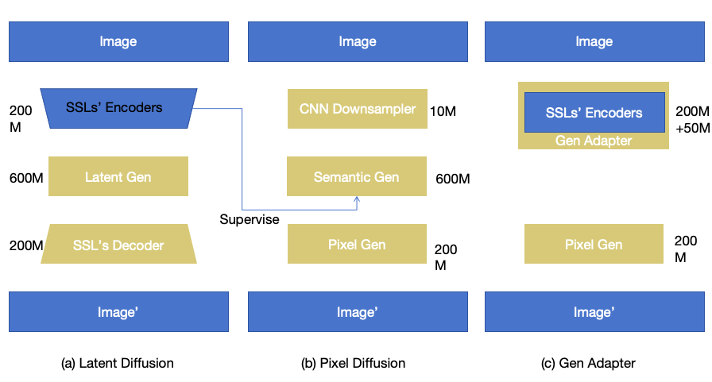

<section class="research-content-section research-content-section--lead" id="question" markdown="1">

01 / Research question

## What changes when we remove the latent bottleneck?

Most image generators first compress images into a latent space and then model the compressed representation. This approach is efficient, but the tokenizer or VAE determines which details are retained and which are discarded before generation begins.

PixelGen asks a direct question: **if the final target is always an image, can the model operate in pixel space from input to output?** Beyond feasibility, we want to understand how pixel-space modeling changes representation learning, computational cost, and the design of diffusion and autoregressive generators.

  Working hypothesis
  
If direct pixel modeling preserves useful visual information, the benefit should not depend on one specific backbone. It should be usable by diffusion, autoregression, and hybrid architectures.

</section>

<section class="research-content-section" id="approach" markdown="1">

02 / Approach

## Four architecture branches

  <article>A<h3>Pixel Diffusion</h3>
Reproduce a PixelDiT-style baseline and test whether REPA and DINOv3 noisy-input fine-tuning improve pixel generation.
<small>Baseline established</small></article>
  <article>B<h3>Dual-level AR</h3>
Generate a global semantic proposal first, then sample pixels within each patch. Multimodal modeling is separated into semantic and pixel levels.
<small>Initial validation complete</small></article>
  <article>C<h3>Latent AR + Pixel Diff</h3>
Use AR for global structure and diffusion to process local pixels jointly, reducing conflicts caused by sequential pixel sampling.
<small>Stage validation complete</small></article>
  <article>D<h3>Hierarchical Pixel AR</h3>
Share one Transformer across RGB scales, then isolate coarse history, local residuals, and phase-parallel patch dependencies.
<small>Current experiment line</small></article>

Three routes into the same question: a latent pipeline, a direct pixel pipeline, and a perceptual model adapted to noisy pixel inputs.

</section>
